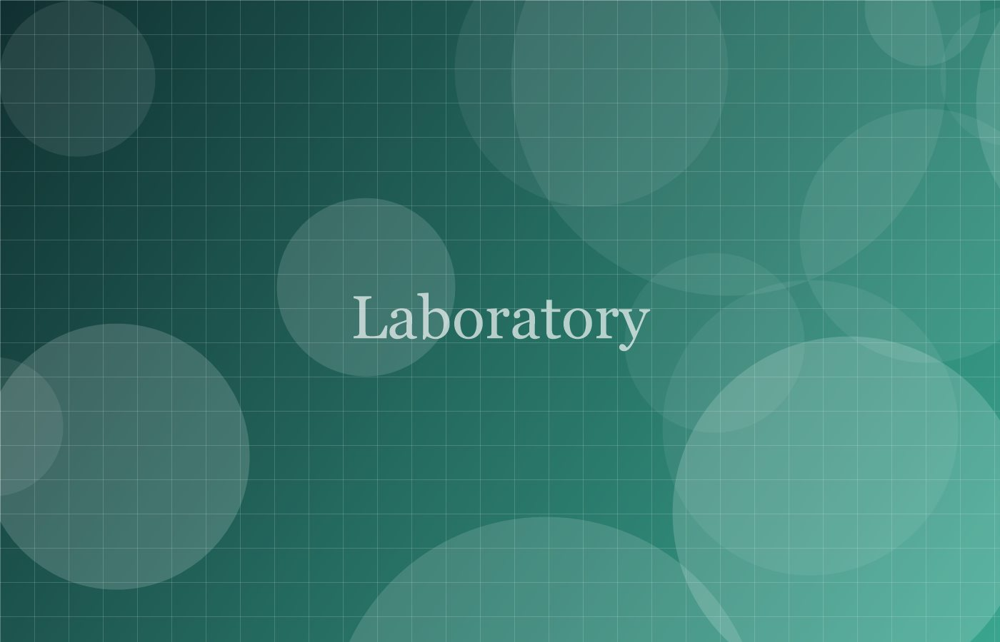

+++
date = '2026-09-15T10:00:00+03:00'
title = 'На кафедре открылась новая лаборатория'
description = 'Новая лаборатория анализа данных оснащена современным вычислительным кластером.'
author = 'Пресс-служба кафедры'
categories = ['Наука']
tags = ['лаборатория', 'анализ данных']
+++
Обложка новости — файл `cover.jpg` в этой же папке. Картинка внутри текста подключается обычным markdown:

Картинка автоматически уменьшается, конвертируется в WebP и загружается лениво.
